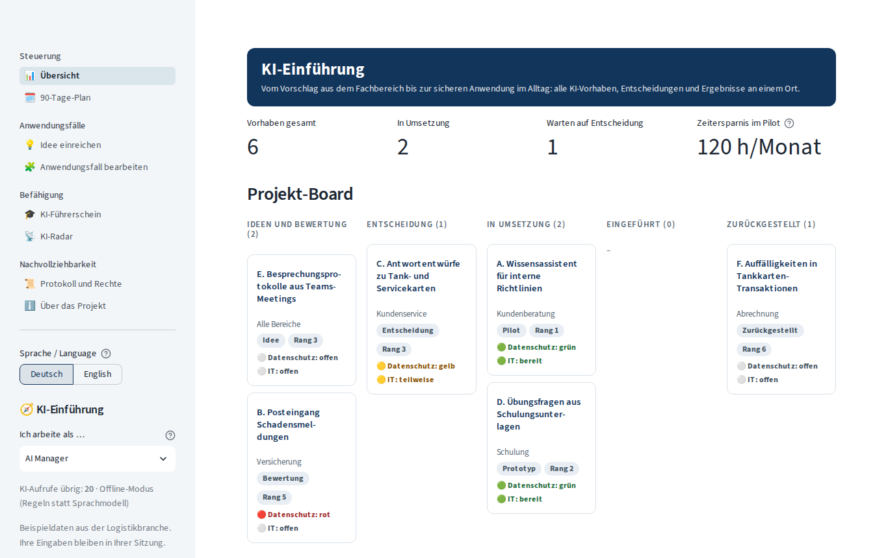

# KI-Einführung

[](https://github.com/sayamrina/ki-einfuehrung/actions/workflows/ci.yml)

**KI-Projekt 2026** · [Live-App](https://ki-einfuehrung-amrina.streamlit.app/) · [Projektseite](https://sayamrina.github.io/ki-einfuehrung/) · [Portfolio](https://sayamrina.github.io/)

Eine Plattform, die den gesamten Arbeitszyklus eines AI Solutions Managers abbildet: Ideen aus dem Fachbereich aufnehmen, Prozesse und Datenschutz prüfen, Anwendungsfälle bewerten, Entscheidungen vorbereiten, Ergebnisse testen, Mitarbeitende schulen und neue Werkzeuge beobachten. Die Oberfläche ist auf Deutsch (Standard) und Englisch verfügbar.

*English: a platform that mirrors the whole work cycle of an AI Solutions Manager, from the first idea of a business unit to data protection, assessment, decision, testing, training and rollout. German is the default language; English can be selected in the sidebar.*



## So nutzen Sie die App

Ein Rundgang von etwa fünf Minuten, Schritt für Schritt erklärt auf der [Projektseite](https://sayamrina.github.io/ki-einfuehrung/#how-to-use): als **Fachbereich** eine Idee einreichen, als **Datenschutz** und als **IT** prüfen und freigeben, als **Geschäftsführung** entscheiden und danach das Ergebnis in der Übersicht und im Protokoll ansehen. Die Rolle wechseln Sie links in der Seitenleiste.

## Der Arbeitszyklus

| Schritt | Seite in der App | Wer darf |
|---|---|---|
| 1. Idee einreichen: Problem in eigenen Worten, die KI erstellt einen Steckbrief (personenbezogene Daten werden vorher ersetzt) | Idee einreichen | Fachbereich, AI Manager |
| 2. Prozessaufnahme: Minuten pro Schritt heute und mit KI, daraus Zeitersparnis pro Monat | Anwendungsfall → Prozessaufnahme | Fachbereich, AI Manager |
| 3a. Datenschutz-Check: Risiken und Schutzmaßnahmen ergeben eine Ampel; Freigabe mit Auflagen | Anwendungsfall → Datenschutz-Check | Datenschutz |
| 3b. IT-Check: Schnittstellen, Hosting, Firmenanmeldung, Betrieb und Kosten; Aufwand in Personentagen; technische Freigabe | Anwendungsfall → IT-Check | IT |
| 4. Bewertung: Nutzen + Umsetzbarkeit − Aufwand − Risiko ergibt Punkte und Rang | Anwendungsfall → Bewertung, Übersicht | AI Manager |
| 5. Entscheidung mit Begründung, erst nach Freigabe durch Datenschutz und IT; Entscheidungsvorlage als PDF | Anwendungsfall → Entscheidung | Geschäftsführung |
| 6. Prüfstand: Wissensassistent mit Quellenangabe, Testfälle und Trefferquote, dokumentierte Grenzen | Anwendungsfall → Prüfstand | AI Manager, Fachbereich, IT |
| 7. 90-Tage-Plan und Projekt-Board | 90-Tage-Plan, Übersicht | alle (lesen) |
| 8. KI-Führerschein: Kurs, Übungen, Abschlusstest, Zertifikat, Auswertung für Trainer | KI-Führerschein | alle |
| 9. KI-Radar und Entscheidungsprotokoll (CSV-Export) | KI-Radar, Protokoll und Rechte | AI Manager und IT pflegen |

Die Rolle wird in der Seitenleiste gewählt. Schritte, die eine Rolle nicht ausführen darf, sind gesperrt und zeigen, wer zuständig ist.

## Grundsätze

- **Datenschutz durch Technikgestaltung:** E-Mail-Adressen, Telefonnummern, IBAN, Kfz-Kennzeichen, Geburtsdaten und Namen werden vor jedem Modellaufruf durch Platzhalter ersetzt ([`kie/privacy.py`](kie/privacy.py)). Eingaben bleiben in der Sitzung und werden nicht gespeichert.
- **Menschen entscheiden:** Punkte und Ampel sind eine Gesprächsgrundlage. Eine Umsetzung ist erst nach Freigabe durch Datenschutz und IT und nach der Entscheidung der Geschäftsführung möglich.
- **Belegte Antworten:** Der Wissensassistent sucht per BM25 in freigegebenen Unterlagen ([`data/wissen`](data/wissen)), antwortet nur daraus und nennt die Quelle. Quellen, die das Modell erfindet, werden verworfen.
- **Funktioniert auch ohne Sprachmodell:** Ohne API-Schlüssel läuft die App in einem regelbasierten Offline-Modus. Pro Besuch sind die KI-Aufrufe begrenzt.

## Lokal starten

```bash
python -m venv .venv && . .venv/bin/activate
pip install -r requirements.txt
export OPENAI_API_KEY=...   # optional, sonst Offline-Modus
streamlit run streamlit_app.py
```

Tests und Linting:

```bash
pip install pytest ruff
ruff check . && pytest
```

Die 28 Tests prüfen Bewertung, Ampel, Zeitersparnis, IT-Check, Pseudonymisierung, Suche und PDF-Erzeugung sowie jede Seite in beiden Sprachen und die Rollenrechte (Streamlit AppTest).

## Aufbau

```
streamlit_app.py      Navigation, Sprache und Rolle
kie/views/            eine Datei pro Seite
kie/scoring.py        Punkte, Rang, Zeitersparnis, Datenschutz-Ampel
kie/privacy.py        Pseudonymisierung vor dem Modellaufruf
kie/knowledge.py      Abschnitte laden, BM25-Suche
kie/llm.py            OpenAI-Aufrufe (JSON-Modus) und Offline-Regeln
kie/pdf.py            Entscheidungsvorlage und Zertifikat
kie/i18n.py           Deutsch und Englisch
data/wissen(_en)/     Beispielunterlagen für den Wissensassistenten
```

## Hinweise

Alle Inhalte sind Beispieldaten aus der Logistikbranche. Schriftart: DejaVu Sans (siehe `assets/FONT-LICENSE.txt`).

This app was built by Amrina, with AI as a supporting tool for coding.
